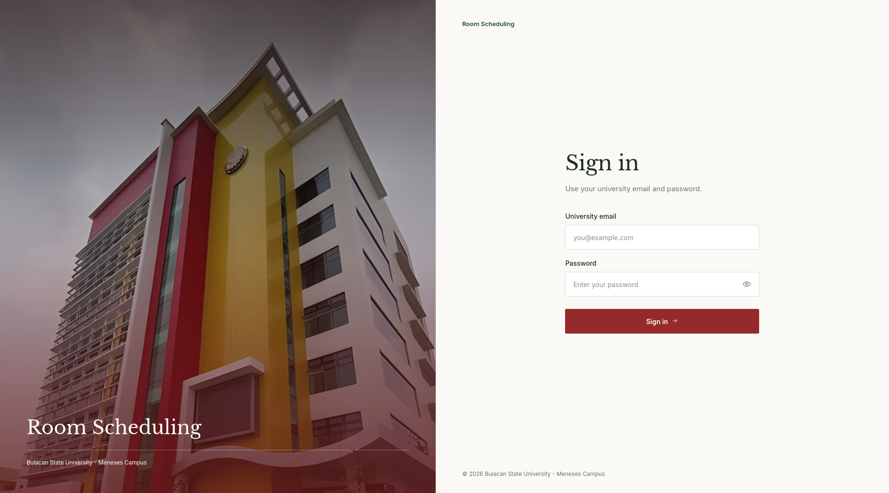
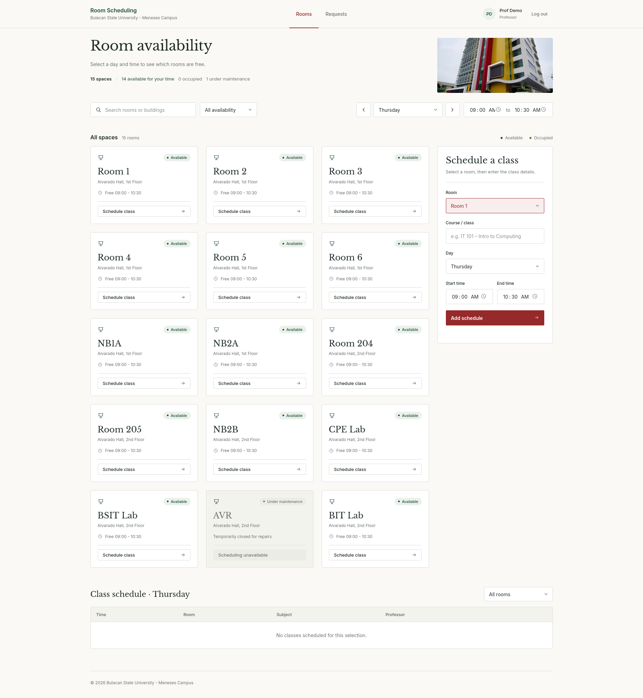
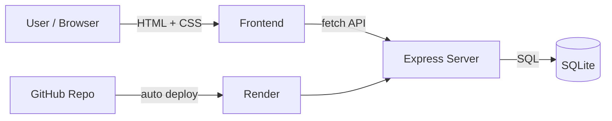

<p align="center">
  
</p>

<p align="center">
  <a href="https://room-scheduler.onrender.com"></a>
  
  
  
  
</p>

<p align="center"><b>A web app for booking and managing campus rooms.</b><br>
<a href="https://room-scheduler.onrender.com">room-scheduler.onrender.com</a></p>

---

## Screenshots

| Sign in | Main page |
|---|---|
|  |  |

## How it works



## Tech stack

| Layer | Tech |
|---|---|
| Frontend | HTML, CSS |
| Backend | Node.js, Express |
| Database | SQLite |
| Hosting | Render (deploys from GitHub) |

## Run locally

```bash
git clone https://github.com/achxearon/room-scheduler.git
cd room-scheduler
npm install
npm start
```

Then open `http://localhost:3000` (adjust the port to match your server).

## Deployment

Pushes to the main branch auto-deploy on [Render](https://render.com).

---

<p align="center">© 2026 Bulacan State University – Meneses Campus</p>
